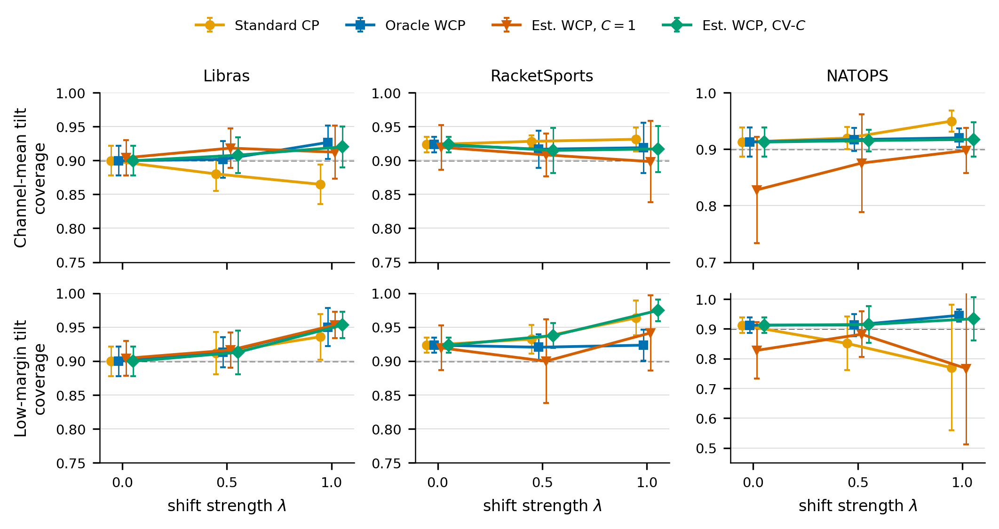
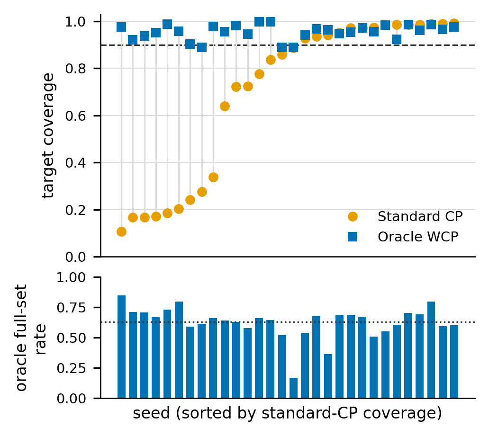

# Weighted Conformal Prediction for Time-Series Classification under Covariate Shift

This repository asks when weighted conformal prediction (WCP) is needed for multivariate time-series
classification under covariate shift, and when estimated importance weights can be trusted. It contains the code
and all results.

Three methods are compared on UEA datasets:

- **Standard split CP**: unweighted.
- **Oracle WCP**: weighted with the exact density ratio.
- **Estimated WCP**: weighted with a ratio from a logistic-regression domain classifier: pre-specified (`C = 1`),
  clipped, cross-validated `C` (CV-C), PCA inputs, or uLSIF.

The design has two parts:

- **Leakage-free (disjoint) protocol.** The classifier is trained on one half of the data. The other half (the
  *pool*) supplies the calibration, unlabelled target and test samples.
- **Controlled covariate shift.** The target is the pool reweighted by exponential tilting,
  `p_T(x) ∝ exp(λ z(x)) p_S(x)`, which gives exact oracle weights. Two tilts are used:
  - *channel-mean tilt*: `z` = mean of the first channel.
  - *low-margin (difficulty-aligned) tilt*: `z` = minus the gap between the classifier's two largest class
    probabilities. It moves mass towards inputs that the classifier finds hard.

## Key results



**Coverage versus shift strength** (α = 0.10, n_cal = 90; mean and 95% CI over 10 seeds; dashed line: nominal level
0.90). Top: channel-mean tilt. Bottom: low-margin tilt.
- Oracle WCP stays valid in every setting.
- Standard CP fails only when the shift moves mass towards hard series: Libras under the channel tilt, NATOPS under
  the low-margin tilt.
- Estimated weights with `C = 1` fail on 168-dimensional NATOPS even without shift. Cross-validated `C` fixes this.



**NATOPS, low-margin tilt, λ = 1, 30 seeds.**
- Standard CP covers 0.696 ± 0.340 (range 0.106–0.992) against 0.955 for oracle WCP (Holm-adjusted p = 0.0051).
- The cost of validity: oracle WCP returns the full label set for 61.5% of target series and covers only 0.859 of
  the rest.

**Replication: coverage failures** (10 datasets, seeds 10–39). Each count is out of 270 settings: 10 datasets × 3
shift strengths λ × 3 levels α × 3 calibration sizes. A failure is a setting whose 95% t-interval of coverage lies
entirely below 1 − α.

| Method | LightGBM, channel tilt | LightGBM, low-margin tilt | MiniRocket, channel tilt | MiniRocket, low-margin tilt |
|---|---:|---:|---:|---:|
| Standard CP | 7 | 107 | 6 | 157 |
| **Oracle WCP** | **0** | **0** | **0** | **0** |
| Estimated WCP, C = 1 | 26 | 53 | 31 | 80 |
| Estimated WCP, C = 1, clip 10 | 10 | 35 | 6 | 49 |
| Estimated WCP, CV-C | 0 | 42 | 0 | 71 |
| Estimated WCP, uLSIF | 4 | 17 | – | 35 |
| APS score: standard CP | 9 | 1 | – | – |
| APS score: estimated WCP, CV-C | – | 0 | – | – |

Four pre-specified comparisons, each tested with a paired Wilcoxon signed-rank test and Holm correction, are all
significant on independent seeds (largest adjusted p = 0.0017). All tables and key numbers are in
[`results/summary_tables.txt`](results/summary_tables.txt).

## Repository layout

```
run_experiment.py          experiment: features, classifier, shifts, standard CP, oracle and estimated WCP, metrics
download_data.py           downloads the UEA datasets into data/
make_synthetic_data.py     synthetic data with the same shapes, for quick tests
scripts/
  run_main.sh              main study: Libras, RacketSports, NATOPS; seeds 0-9; 10 configurations
  run_followup.sh          extended CV grid for C; low-margin run with 30 seeds
  run_replication.sh       10 datasets, seeds 10-39, 17 configurations
  run_h2_fresh.sh          independent test of H2 on seeds 40-69
analysis/
  summary_tables.py        all summary tables and key numbers -> results/summary_tables.txt
  make_figures.py          main figures -> figures/
  plot_results.py          per-run diagnostic plots -> results/<group>/<run>/figures/
  analyze_followup.py      analysis of the follow-up runs
  analyze_h2_fresh.py      H2 on seeds 40-69 and the Holm table of the replication
docs/H2_fresh_plan.txt     analysis plan for the H2 test, written before its run
results/                   all results (see below)
figures/                   main figures (PDF and PNG)
tests/                     unit tests
```

## Results

| Folder | Content |
|---|---|
| `results/main/` | Libras, RacketSports, NATOPS; seeds 0–9; channel-mean and low-margin tilts; C = 1, clipping, CV-C, PCA, tilting-variable and C = 0.1 ratio models; in-pool protocol (`in_pool`) for comparison |
| `results/followup/` | CV grid for C extended to [1e-5, 1e2] (30 values); low-margin run with seeds 0–29 |
| `results/replication/` | 10 datasets, seeds 10–39; LightGBM and MiniRocket; LAC and APS scores; natural train/test shift |
| `results/h2_fresh/` | low-margin run on seeds 40–69; Holm table of the replication (`h2_fresh_holm.csv`) |
| `results/summary_tables.txt` | all summary tables and key numbers |

Each run folder contains:
- `summary.csv`: mean, SD and 95% t-interval over seeds for each dataset × λ × n_cal × α × method.
- `raw_results.csv`: one row per seed. In `results/replication/` these files are gzipped (`raw_results.csv.gz`);
  `pandas.read_csv` reads them directly.
- `table2–4_*.csv`: summary tables.
- `figures/`: diagnostic plots of coverage, set size and ESS ratio against λ and n_cal.

Main columns:
- `coverage`, `set_size`, `singleton_rate`, `empty_rate`
- `full_set_rate`: share of sets that contain every class
- `coverage_nonvacuous`: coverage on the other sets
- `inf_threshold_rate`, `ess_ratio`
- `w_spearman`, `w_nmae`: estimated weights against oracle weights
- `ratio_C`: selected C
- `target_acc`
- `domain_auc`: natural shift only

Methods: `standard`, `oracle`, `estimated` (no clipping), `estimated_clip10`, `estimated_clip20`.

## Setup

Python ≥ 3.9.

```bash
python -m venv venv && source venv/bin/activate
pip install -r requirements.txt
python -m pytest -q tests
```

## Reproducing the results

Run every command from the repository root.

```bash
python download_data.py --data-dir data          # 10 UEA datasets

bash scripts/run_main.sh data                     # -> results/main/
bash scripts/run_followup.sh data                 # -> results/followup/      (needs results/main)
bash scripts/run_replication.sh data              # -> results/replication/
bash scripts/run_h2_fresh.sh data                 # -> results/h2_fresh/      (needs followup and replication)

python analysis/summary_tables.py                 # -> results/summary_tables.txt
python analysis/make_figures.py --out figures     # -> figures/
python analysis/plot_results.py --summary results/main/disjoint/summary.csv   # per-run plots
```

- **Resuming.** Each run script skips a configuration whose `summary.csv` already exists. To rerun from scratch,
  write to a new folder, for example `OUT_DIR=results_new/main bash scripts/run_main.sh data`.
- **Without the data.** The analysis scripts work on the stored results.
- **Seeds.** The random stream of each run is `SeedSequence([base_seed, dataset_position, seed])`, so keep the
  dataset order used in the scripts.
  - Seeds 0–9 (main study), 10–39 (replication) and 40–69 (H2) are disjoint.
  - The one exception: the low-margin runs on the first three datasets share seeds 10–29 between the follow-up and
    the replication. For that reason H2 is retested on seeds 40–69.
- **Old folder names.** `docs/H2_fresh_plan.txt` is kept exactly as written before its run and uses the earlier
  folder names: `results_v3_1` = `results/followup`, `results_v3` = `results/replication`,
  `results_h2_fresh` = `results/h2_fresh`.

## Quick test without the real data

```bash
python make_synthetic_data.py --out-dir data_synthetic
OUT_DIR=results_synthetic/main EXTRA_ARGS="--n-seeds 1" bash scripts/run_main.sh data_synthetic
```

## Options

- `python run_experiment.py --help` lists every option.
- MiniRocket (`--classifier minirocket`) and `download_data.py` require `aeon`.
- The in-pool protocol is selected with `--protocol paper`. That is the option's historical name in the code.
- `--null-fallback` and `--ratio-crossfit` are implemented but not used in these experiments. They are kept so that
  the code is exactly the version that produced the results.
